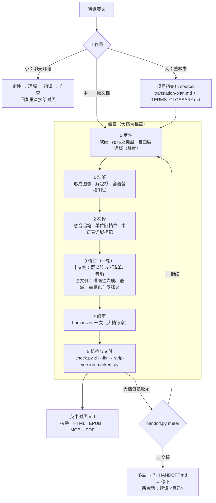

# en-zh-max 工作流（v4）

| 步骤 | 依据（references/methods.md） | 准出 |
|---|---|---|
| 0 定性 | 第 1、2、3 法 | 档位、自由度、类型、语域四项已定（大档写进 translation-plan.md） |
| 1 理解 | 第 4、5、6、7、8 法 | 能用中文说出每段的意思 |
| 2 初译 | 第 9、10、11 法 | 全文初稿完成，术语表的语域标记已逐一落实 |
| 3 修订 | 第 12、13、14、15 法 + translationese-symptoms.md | 两张清单都过完一遍 |
| 4 终审 | humanizer | 整章过一次 |
| 5 机检交付 | check.py、strip-version-markers.py | 标点残留为 0，署名和项目地址齐全 |
| 大档收尾 | references/handoff.md、handoff.py | 跑过 meter；报「→ 交接」时已落盘、写好 HANDOFF.md、会话停下 |
